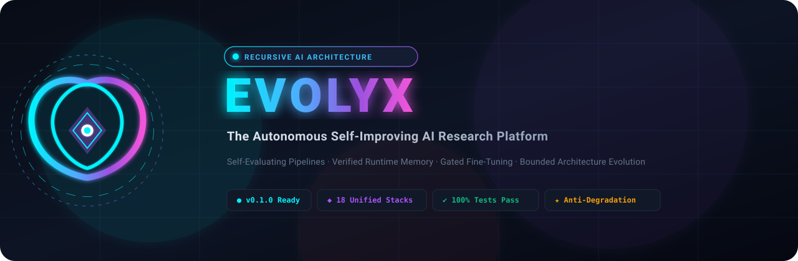
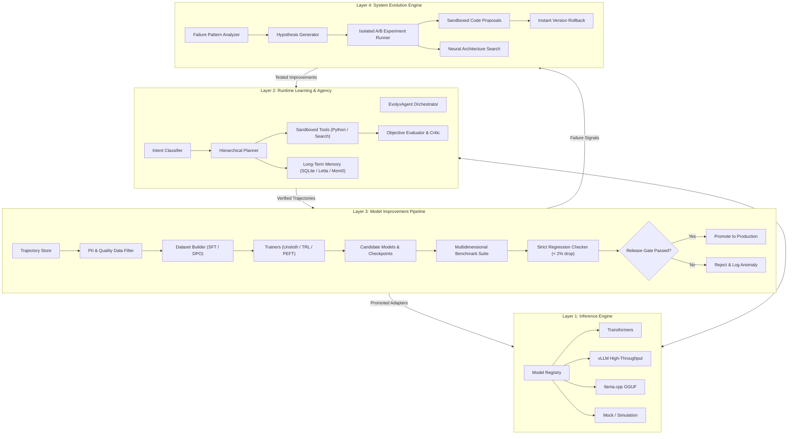

<div align="center">



<br/><br/>

[](https://python.org)
[](LICENSE)
[-success?style=for-the-badge&logo=pytest&logoColor=white)](tests/)
[](.github/workflows/ci.yml)
[](upstream/manifest.json)
[](docs/INTEGRATIONS.md)

<p align="center">
  <b>The Unified Open-Source Platform for Autonomous, Continuously Self-Improving Artificial Intelligence.</b>
  <br />
  Runs Locally &bull; Learns from Experience &bull; Synthesizes Training Data &bull; Fine-Tunes Adapters &bull; Proposes Architecture Evolutions
</p>

[Vision](#-the-vision-what-we-are-building) •
[Why EVOLYX](#-the-core-engineering-challenge) •
[Architecture](#-the-4-operational-layers) •
[Evolution Engine](#-the-4-levels-of-autonomous-evolution) •
[Upstream Repos](#-unified-upstream-ecosystem) •
[Quickstart](#-quickstart--installation) •
[Safety & Governance](#-safety-governance--anti-hallucination)

---

</div>

## 🌌 The Vision: What We Are Building

Contemporary large language models suffer from a fundamental constraint: **they are static artifacts frozen at the point of training**. They forget lessons between sessions, cannot autonomously acquire new skills without human engineers, and quickly degrade or hallucinate if allowed to train blindly on their own unverified outputs.

**EVOLYX** is built to break this paradigm.

Our ambition is an integrated, sovereign AI research platform that:
1. **Runs Privately**: Deploys on consumer hardware, local GPU workstations, or private cloud clusters without vendor lock-in or telemetry leaks.
2. **Remembers Comprehensively**: Maintains distinct conversational, procedural, and factual long-term memories with verified provenance and PII scrubbing.
3. **Acts & Researches Autonomously**: Formulates multi-step plans, writes and executes code in secure sandboxes, and searches external documentation when uncertain.
4. **Reflects Critically**: Scores its own solutions against objective unit tests, factual citations, and quality metrics before presenting answers.
5. **Generates Verified Training Data**: Curates successful task trajectories and user corrections into high-grade SFT, DPO, and GRPO datasets.
6. **Fine-Tunes its Own Weights**: Periodically fine-tunes candidate LoRA/QLoRA adapters and tests candidate checkpoints offline.
7. **Gates Every Promotion**: Compares new candidate models against fixed benchmarks and regression suites—promoting only models that demonstrably improve without degrading baseline skills.
8. **Evolves Its Own Code & Architecture**: Autonomously proposes prompt revisions, source code patches, and bounded neural architecture changes (layer scaling, MoE routing) in isolated branches.

---

## ⚡ The Core Engineering Challenge

> **"No single repository provides unlimited self-improvement or intelligence growth out of the box."**

True recursive self-improvement cannot be achieved by merely connecting an agent to a training script. Blind self-training causes **model collapse**, reinforces hallucinations, and catastrophic forgetting.

EVOLYX solves this through **decoupled multi-layer architecture**:
- **Runtime Inference** is strictly separated from **Weight Training**.
- **Working Memory** enhances performance instantly at zero training cost.
- **Offline Training** operates exclusively on **verified, test-proven trajectories**.
- **System Evolution** occurs inside **sandboxed experiments with explicit regression gates and rollbacks**.

---

## 🏛️ The 4 Operational Layers



---

## 🔁 The 5-Stage Continuous Improvement Loop

```
  [1. OBSERVE & ACT] ──► [2. VERIFY & STORE] ──► [3. DISTILL DATA]
          ▲                                              │
          │                                              ▼
  [5. GATE & PROMOTE] ◄───────────────────────── [4. TRAIN CANDIDATE]
```

1. **Observe & Act (Runtime)**: The agent decomposes user requests into actionable DAG plans, queries relevant memories, and invokes tools.
2. **Verify & Store**: The objective critic tests the output. If execution is backed by passing assertions, it records the trajectory and updates verified procedural memory.
3. **Distill Data**: The learning pipeline scrubs secrets, removes duplicates, balances task curriculum, and builds versioned SFT/DPO manifests.
4. **Train Candidate**: Training adapters launch parameter-efficient fine-tuning (LoRA via Unsloth/TRL/PEFT) on offline compute.
5. **Gate & Promote**: The promotion manager tests the candidate against a multi-benchmark battery. If any existing capability drops by more than 2.0%, the candidate is rejected. If it achieves superior overall scores, it is promoted to production with an immutable checkpoint pointer.

---

## 🧬 The 4 Levels of Autonomous Evolution

EVOLYX is architected to evolve across four distinct tiers of autonomy:

| Level | Name | How It Operates | Safeguards |
| :---: | :--- | :--- | :--- |
| **1** | **Prompt & Workflow Evolution** | Adapts instructions, tool-routing parameters, and decomposition heuristics dynamically based on failure patterns. | Fixed benchmark validation against the current baseline prompt. |
| **2** | **Model-Weight Evolution** | Targets model weaknesses by generating focused curriculum datasets and fine-tuning specialized LoRA adapters. | Regression test suite comparing candidate model weights to production. |
| **3** | **Software Self-Patching** | Generates proposed code changes to EVOLYX's runtime or tools, spins up an isolated sandbox, and runs unit tests. | AST forbidden call detection + full automated test suite pass. |
| **4** | **Architecture Search** | Explores structural capacity: adapter rank scaling, layer replication, and Mixture-of-Experts (MoE) router configurations. | Bounded FLOP and VRAM budgets; offline checkpoint compatibility verification. |

---

## 🌐 Unified Upstream Ecosystem

EVOLYX synthesizes 18 industry-leading open-source frameworks. Rather than merging disparate source codes into a fragile monolith, EVOLYX keeps them pinned in [`upstream/`](upstream/) and connects them through high-performance Python adapters:

```
                                  ┌───────────────────────────┐
                                  │      EVOLYX PLATFORM      │
                                  └─────────────┬─────────────┘
                                                │
         ┌───────────────────┬──────────────────┼───────────────────┬───────────────────┐
         ▼                   ▼                  ▼                   ▼                   ▼
    [INFERENCE]         [TRAINING]          [MEMORY]            [AGENTS]           [RESEARCH]
     • Transformers      • Unsloth          • Letta (MemGPT)    • LangGraph         • OLMo Core
     • vLLM              • TRL              • Mem0              • OpenHands         • OLMo
     • llama.cpp         • PEFT             • SQLite Engine     • DSPy              • Qwen / Qwen 2.5
                         • Axolotl                              • LlamaIndex
                         • OpenRLHF
```

---

## 📂 Project Structure

```
EVOLYX/
├── assets/                      # Official vector logo, icon, and banner graphics
│   ├── logo.svg
│   └── banner.svg
├── upstream/                    # Pinned original upstream repositories (TRL, Unsloth, etc.)
│   └── README.md
├── evolyx/                      # Primary integrated platform package
│   ├── core/                    # Protocols, schemas, model registry, inference engine
│   ├── runtime/                 # Intent classifier, planner, tool router, orchestrator
│   ├── memory/                  # Long-term SQLite, short-term, quality gates, knowledge store
│   ├── tools/                   # Web search, document search, Python executor, sandboxing
│   ├── learning/                # Trajectory store, feedback collector, dataset builder
│   ├── training/                # SFT, DPO, GRPO pipelines, checkpoints manager
│   ├── evaluation/              # Benchmarks, factuality evaluator, regression checker
│   ├── evolution/               # Hypothesis generator, experiment runner, code proposals
│   ├── control/                 # RBAC permissions, resource governor, audit logger
│   └── storage/                 # Database, artifact store, event bus
├── configs/                     # Central system configuration YAML files
├── apps/                        # Entry points: CLI, FastAPI server, Dashboard
├── integrations/                # Adapters connecting upstream frameworks to EVOLYX
├── artifacts/                   # Immutable storage for checkpoints, datasets, and reports
├── tests/                       # Unit, integration, and adversarial safety suite
├── scripts/                     # PowerShell & Bash automation scripts
├── pyproject.toml               # Python project configuration
├── docker-compose.yml           # Containerized orchestration
└── Dockerfile                   # Production Docker image
```

---

## 🚀 Quickstart: Universal Installation on Any Device

EVOLYX includes an intelligent hardware detector and automated cross-platform installers that automatically configure the environment for your specific device (CPU laptop, NVIDIA GPU server, Apple Silicon Mac, or Docker container).

### ⚡ 1-Command Installation

<table>
<tr>
<th>Platform</th>
<th>Command</th>
<th>Hardware Target</th>
</tr>
<tr>
<td><b>Windows (PowerShell)</b></td>
<td>

```powershell
powershell -ExecutionPolicy Bypass -File .\install.ps1
```
</td>
<td>Auto-detects CPU / NVIDIA CUDA GPU</td>
</tr>
<tr>
<td><b>Linux / Cloud Server</b></td>
<td>

```bash
chmod +x install.sh && ./install.sh
```
</td>
<td>Auto-detects CPU / NVIDIA CUDA / AMD ROCm</td>
</tr>
<tr>
<td><b>macOS (Apple Silicon & Intel)</b></td>
<td>

```bash
chmod +x install.sh && ./install.sh
```
</td>
<td>Auto-detects Apple Silicon M1/M2/M3/M4 Metal (MPS)</td>
</tr>
<tr>
<td><b>Docker / Headless Server</b></td>
<td>

```bash
docker compose up -d
```
</td>
<td>Zero host dependencies; instant containerized API + Dashboard</td>
</tr>
<tr>
<td><b>Python Direct (Any Device)</b></td>
<td>

```bash
python install.py --profile auto
```
</td>
<td>Custom profiles: <code>auto</code>, <code>cpu</code>, <code>gpu</code>, <code>mac</code>, <code>dev</code></td>
</tr>
</table>

---

### 🧪 Immediate Verification & Comprehensive Self-Test
Run the built-in 46-test battery (unit, end-to-end integration, AST sandbox security, prompt injection defense, PII scrubbing, LoRA adapter backpropagation, and regression gating):

```bash
# Run the entire test suite across all modules:
pytest tests/ -v
```
*All 46 tests execute in **~6.7s** on CPU with **zero external model downloads required**.*

#### 🚀 Run the Reproducible Neural Training & Promotion Pipeline
Verify real neural backpropagation, loss reduction, SHA256 checkpointing, held-out evaluation, and atomic promotion in a single command:
```bash
# Fast in-memory Micro Transformer training:
python scripts/train_pipeline.py --backend micro --version v002 --epochs 5

# Parameter-efficient LoRA adapter training engine:
python scripts/train_pipeline.py --backend adapter --version v003 --epochs 5
```

---

### 🎮 Operating EVOLYX

#### 1. Interactive Research Terminal
Launch the conversational agent:
```powershell
.\scripts\run_cli.ps1 chat
```

#### 2. Execute an Autonomous Single Task
Decompose, plan, query tools, and verify output:
```powershell
.\scripts\run_cli.ps1 task "Search for the latest methods in preference optimization"
```

#### 3. Trigger an Autonomous Evolution Cycle
Diagnose failures, propose hypotheses, run A/B experiments, and test regression release gates:
```powershell
.\scripts\run_experiment.ps1
```

#### 4. Launch the REST API
Start the production-ready FastAPI server:
```powershell
.\scripts\run_api.ps1
```
Interactive OpenAPI documentation will be accessible at `http://127.0.0.1:8000/docs`.

#### 5. Open the Experiment Dashboard
Inspect candidate checkpoints, datasets, and platform health:
```powershell
python -m apps.dashboard.app
```

---

## 🛡️ Safety, Governance & Anti-Hallucination

1. **AST Tool Sandboxing**: Python tool execution validates every snippet through the Abstract Syntax Tree before running, blocking forbidden imports (`os.system`, `subprocess`, `ctypes`, `shutil.rmtree`).
2. **PII & Secret Sanitization**: Trajectories, queries, and long-term memories pass through regex scrubbers that automatically redact API keys (`[SECRET_REDACTED]`), email addresses (`[EMAIL_REDACTED]`), and IP addresses (`[IP_REDACTED]`).
3. **Zero Runtime Weight Drift**: Model weights are never modified directly during active chat. All interactions are collected as experience records and undergo offline evaluation before any candidate adapter is fine-tuned.
4. **Automated Rollback**: The system maintains an active pointer (`ACTIVE_VERSION.txt`). If anomalies or regressions are detected post-deployment, EVOLYX executes single-command rollbacks to prior production checkpoints.

---

## 🗺️ Engineering Roadmap

- [x] **Phase 1: Foundation & Architecture** (Protocols, Mock Backends, CLI, REST API, Test Suite)
- [x] **Phase 2: Runtime Intelligence** (Intent classification, hierarchical planning, AST tool sandbox)
- [x] **Phase 3: Learning & Memory** (SQLite long-term memory, PII filter, SFT dataset builder)
- [x] **Phase 4: Evolution & Gating** (Hypothesis generator, benchmark suite, regression gates, promotion manager)
- [ ] **Phase 5: Distributed Scaling** (vLLM production clusters, multi-node OpenRLHF training, deep OLMo-core MoE experiments)

---

## 📄 License & Attribution

EVOLYX is licensed under the [Apache 2.0 License](LICENSE).
The upstream repositories preserved in `upstream/` maintain their respective open-source licenses (Apache 2.0, MIT, BSD).

<div align="center">
  <sub>Engineered for the future of sovereign, autonomous, continually evolving intelligence.</sub>
</div>
